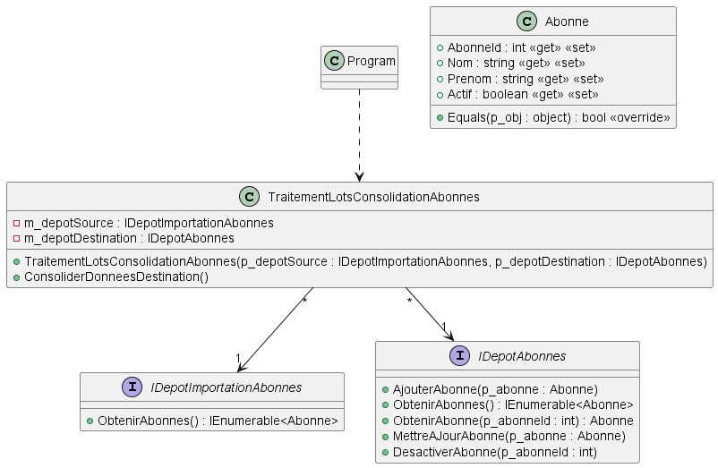

# Module 02 - Tests unitaires

Ce module vous propose de découvrir et de pratiquer les tests unitaires en C# à travers des exercices concrets.  
Vous apprendrez à écrire des tests automatisés, à utiliser des frameworks de tests (xUnit), à simuler des dépendances avec des mocks (Moq), à vérifier les comportements attendus, et à améliorer la robustesse de votre code grâce à la validation automatique.

Les exercices abordent :

- La création et l'exécution de tests unitaires sur des classes existantes
- L'utilisation de frameworks de tests et de bibliothèques d'assertions avancées
- La simulation de dépendances et la vérification des interactions
- La consolidation de données avec validation par tests

---

## Exercice 1 - Questionnaire

**Introduction :**  
Cet exercice a pour objectif de vous familiariser avec l’écriture de tests unitaires sur une classe métier existante. Vous apprendrez à utiliser les outils xUnit, Moq et FluentAssertions pour vérifier le comportement de méthodes et propriétés, contrôler les interactions entre objets et garantir la fiabilité du code lors de modifications.

Reprenez le code fourni dans le même répertoire que ce fichier d'exercices.

***Attention : une correction partielle est présente dans la solution, ne la consultez pas avant d'avoir tenté l'exercice !***

1. Créez un nouveau projet de tests xUnit nommé `Tests_Perso_POOII_Module02_Tests` et ajoutez-y une référence vers le projet à tester.
2. Installez les paquets NuGet suivants dans votre projet de tests :
   - `Moq` (pour la création de mocks)
   - `FluentAssertions` (pour des assertions plus expressives)
3. Écrivez des tests unitaires pour les méthodes et propriétés suivantes, en validant :
   - Le nombre d'appels aux méthodes attendues
   - L'absence d'appel aux méthodes/propriétés non essentielles
   - Les méthodes/propriétés à tester sont :
     1. `CorrigerQuestions`
     2. `TotalPoints`
     3. `Score`
     4. `PoserQuestions`
4. Modifiez le code de `PoserQuestions` pour qu'il appelle plusieurs fois la méthode `PoserQuestion` des questions. Vérifiez que certains de vos tests échouent (cela valide la pertinence de vos tests).
5. Modifiez le code de `PoserQuestions` pour qu'il appelle d'autres méthodes ou propriétés des questions. Vérifiez que certains de vos tests échouent.

**Conseil :**  
Pour chaque méthode testée, pensez à vérifier les cas normaux et les cas limites (ex : liste vide, question déjà corrigée, etc.).

---

## Exercice 2 - Consolidation d'un dépôt de données

**Introduction :**  
Cet exercice vous propose de tester une logique métier de synchronisation de données entre deux dépôts. Vous allez pratiquer la conception orientée test (TDD), la création de mocks pour simuler des dépendances, et la validation du comportement d’un algorithme de consolidation. L’objectif est de garantir que toutes les situations de synchronisation sont correctement gérées et testées.

Vous devez écrire un programme (`TraitementLotsConsolidationAbonnes`) qui met à jour le dépôt de données de destination contenant des abonnés à partir d'un autre dépôt de données source.

### Description

- Le dépôt source est représenté par l'interface `IDepotImportationAbonnes` qui ne comporte qu'une méthode `ObtenirAbonnes` renvoyant un `IEnumerable<Abonne>`.
- Le dépôt destination est représenté par l'interface `IDepotAbonnes` qui comporte les quatre méthodes de CRUD ainsi qu'une méthode qui renvoie tous les abonnés :
  - `AjouterAbonne` : ajoute un abonné actif au dépôt
  - `ObtenirAbonne` : renvoie un abonné quel que soit son statut
  - `ObtenirAbonnes` : renvoie tous les abonnés actifs
  - `MettreAJourAbonne` : met à jour les informations d'un abonné actif
  - `DesactiverAbonne` : modifie le statut d'un abonné actif pour le passer à inactif

Le schéma UML suivant résume la structure autour de `TraitementLotsConsolidationAbonnes` :

L'algorithme de consolidation des données fonctionne comme suit :

- Si un abonné est présent dans la source mais pas dans la destination, il faut l'ajouter dans la destination.
- Si un abonné est présent dans les deux dépôts, il faut vérifier si ses données sont identiques (hors statut "Actif"). Si ce n'est pas le cas, on doit mettre à jour le dépôt destination. Si l'abonné n'est pas actif dans la destination, il faut le réactiver.
- Si un abonné est présent dans la destination mais pas dans la source, il doit être désactivé dans la destination.

### À faire

1. Créez un nouveau projet console nommé `M02_UT_ConsolidationAbonnes`.
2. Codez les classes du diagramme :
   - La fonction `Main` peut rester vide.
   - La classe `Abonne` ne contient que des propriétés et la méthode `Equals` (à redéfinir). La méthode `Equals` ne doit pas tenir compte de l'état "Actif".
   - Les interfaces sont à écrire mais **pas à implanter** (utilisez des mocks pour les tests).
   - Laissez la méthode `ConsoliderDonneesDestination` de la classe `TraitementLotsConsolidationAbonnes` vide pour commencer.

Pour chaque cas de test ci-dessous :

- Analysez sur papier le scénario :
  - Quels sont les ensembles de données source et destination ?
  - Quelles méthodes doivent être appelées sur les dépôts ?
- Écrivez un test unitaire pour la méthode `ConsoliderDonneesDestination` correspondant à ce cas.
- Implémentez la méthode `ConsoliderDonneesDestination` pour faire passer le test, en procédant étape par étape.

**Cas de test à couvrir :**

1. La source contient un abonné, la destination est vide.
2. La source est vide, la destination contient un abonné.
3. La source et la destination contiennent le même abonné avec les mêmes informations.
4. La source et la destination contiennent le même abonné mais avec un prénom différent.
5. La source contient 3 abonnés : un absent de la destination, un identique à la destination, un différent sur le prénom. La destination contient un abonné de moins que la source.
